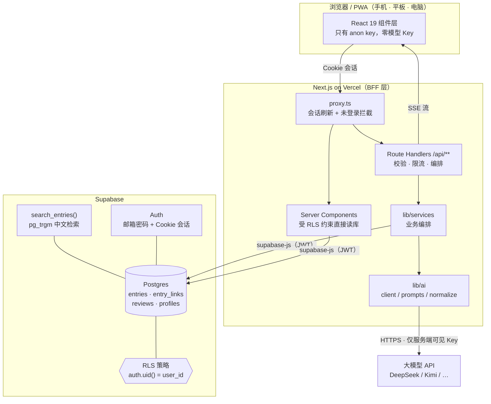
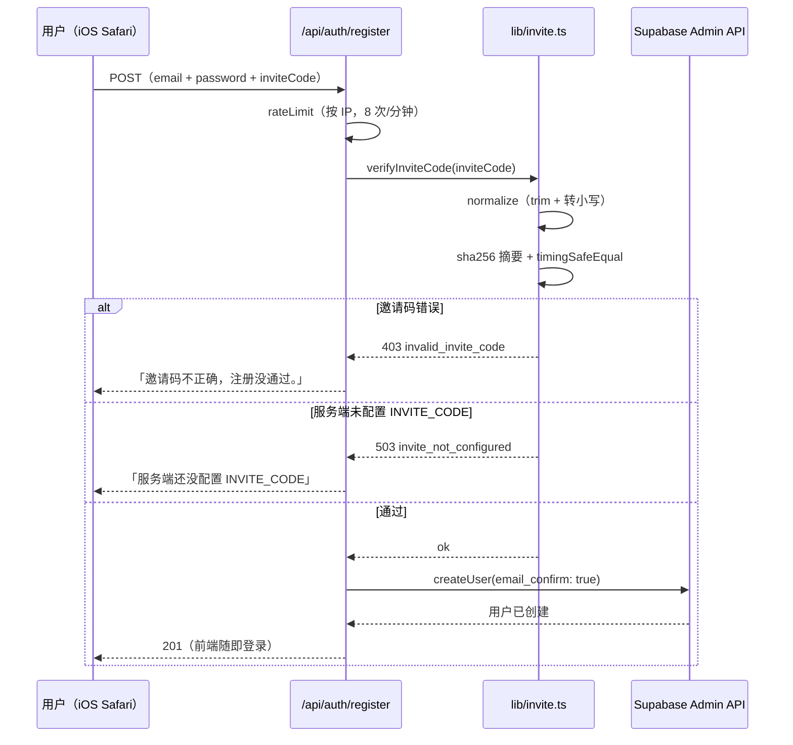

# 信息管家 · Info Keeper

> 一个把「随手记」变成「可检索知识库」的个人信息管家：AI 自动理解、自动串联，再用 RAG 问答把答案连同出处一起还给你。

[](https://nextjs.org)
[](https://react.dev)
[](https://www.typescriptlang.org)
[](https://supabase.com)
[](https://tailwindcss.com)
[](LICENSE)
[](https://github.com/congcongrikka/info-keeper/actions/workflows/ci.yml)
[](https://github.com/congcongrikka/info-keeper/releases)

**线上体验**：本项目不含预置公开实例，请自行部署后访问自己的地址（下文示例统一写作 `https://your-deployment.example.com`）。实例为邀请制，需要邀请码才能注册。

---

## 亮点速览

| | 能力 | 实现要点 |
| --- | --- | --- |
| 🤖 | **AI Agent 式信息整理** | 一次写入触发一次结构化推理：类型判别、标题生成、摘要、标签、重点、下一步、优先级、截止时间，全部落到数据库列上，而不是塞进一段自由文本 |
| 🔍 | **RAG 检索增强问答** | Postgres `pg_trgm` 中文三元组检索召回 → 待办/命中/最近三路合并去重 → 字符预算裁剪 → 流式回答，句末标注 `[1][2]` 并可跳转原文 |
| 🔗 | **条目自动串联** | 模型从近期记录里挑出真正相关的条目，写入 `entry_links`（`related` / `duplicate` / `follow_up` / `contradicts`），详情页双向可见 |
| 🏢 | **多租户隔离（双保险）** | 数据库层 RLS（`auth.uid() = user_id`）+ 应用层每个查询函数强制接收 `userId`，不依赖单点防护 |
| 🎫 | **邀请码制注册** | 服务端 `sha256` + `timingSafeEqual` 校验、IP 限流、fail-closed（不配置即关闭注册），配合 Supabase Admin API 可实现「关掉公开注册后唯一入口」 |
| 📱 | **PWA + iOS 适配** | standalone 显示、离线兜底页、主屏图标；`@supports` 与字号兜底解决 iOS 聚焦缩放、安全区、Cookie 与主屏应用分叉等真机问题 |
| 🔔 | **每日早报（双通道）** | Vercel Cron（UTC `0 0 * * *`）→ 跨用户聚合待办数 → **Web Push**（分设备、410/404 自动清理）+ **邮件**（nodemailer/SMTP，安卓国行收不到 FCM 推送时的兜底）；`CRON_SECRET` fail-closed |
| 🎨 | **可插拔主题视觉** | 「午夜深空 + 葱绿霓虹」设计令牌体系 + `mask-image` 融化 + 径向光晕；角色插画为**可选素材**（不随仓库分发），缺失时自动降级为中性占位 |
| 📦 | **无 UI 组件库** | 运行依赖只有 Next / React / Supabase / zod / lucide 图标，所有组件基于 Tailwind v4 `@theme` 令牌手写，体积小、可控性高 |

## 项目简介

大多数笔记工具的问题不是「记不下来」，而是记下来之后就死了。这个项目围绕三件事设计：

1. **记的时候不打断你** —— 一个输入框，不分文件夹、不选标签，写完就走。
2. **记完之后有人整理** —— 模型负责起标题、判断类型、写一句话摘要、打标签，并从旧记录里找出真正相关的那几条。
3. **要用的时间能问出来** —— 「我上次那个方案想到哪了」「这周有什么没做完」，回答只基于你自己写下的内容，带出处。

它既是**学习辅助**（把散落的知识点串成体系），也是**工作辅助**（待办自动排期、阶段复盘），更是一份可以随时导出、完全归属自己的数据。

## 技术栈

**前端**

- **Next.js 16**（App Router / Server Components / Route Handlers / Proxy 中间件）
- **React 19** + **TypeScript 5.9**（`strict: true`）
- **Tailwind CSS 4**（`@theme` 令牌 + `@layer` 分层，无 UI 组件库）
- **lucide-react** 图标
- **PWA**：手写 Service Worker + Web App Manifest

**后端 / 数据**

- **Supabase**：Postgres + Auth（邮箱密码）+ RLS + `pg_trgm` 全文检索
- **Route Handlers** 作为 BFF 层：唯一能接触模型 Key 的地方
- **zod 4**：所有写接口的请求校验 + 模型输出归一化防线
- **@supabase/ssr**：Cookie 会话，在 Proxy 层每次请求刷新

**AI**

- **OpenAI 兼容协议**的大模型（DeepSeek / Kimi / 通义 / OpenAI），换模型只改环境变量
- 结构化输出 + 归一化清洗（`normalizeAnalysis` / `normalizeReview` / `normalizeTaskPlan`），非法枚举、超时、超长一律收敛
- SSE 流式问答，客户端断开时服务端安全收尾

**部署**

- **Vercel**（`sin1` 新加坡区，与 Supabase 就近）
- 环境变量区分 Secret / Config 类型

## 架构图



**关键约束**：`AI_API_KEY` / `INVITE_CODE` / `SUPABASE_SERVICE_ROLE_KEY` 都不带 `NEXT_PUBLIC_` 前缀，只在 Route Handler 里通过 `process.env` 读取，编译产物中不会出现，浏览器永远拿不到。

## 目录结构

```text
info-keeper/
├─ src/
│  ├─ app/
│  │  ├─ (app)/                          ← 需要登录的页面组（共用 AppShell）
│  │  │  ├─ layout.tsx                    登录守卫 + 侧栏/底栏
│  │  │  ├─ page.tsx                      收件箱（记录流 + 筛选 + 搜索）
│  │  │  ├─ entry/[id]/page.tsx           条目详情（编辑 + AI 面板 + 关联）
│  │  │  ├─ chat/page.tsx                 智能问答（RAG + 流式）
│  │  │  ├─ tasks/page.tsx                待办与 AI 排期
│  │  │  ├─ insights/page.tsx             阶段总结
│  │  │  ├─ settings/page.tsx             账号 / 备份 / PWA 安装
│  │  │  ├─ loading.tsx                   骨架屏
│  │  │  └─ error.tsx                     错误兜底
│  │  ├─ api/                             ← BFF 层，唯一能碰密钥的地方
│  │  │  ├─ entries/route.ts              GET 列表检索 / POST 新建（含 AI 理解）
│  │  │  ├─ entries/[id]/route.ts         PATCH 更新 / DELETE 删除
│  │  │  ├─ entries/[id]/analyze/route.ts 重新理解 / 提取重点
│  │  │  ├─ ai/chat/route.ts              流式问答（SSE）
│  │  │  ├─ ai/review/route.ts            生成阶段总结
│  │  │  ├─ ai/tasks/route.ts             整理待办
│  │  │  ├─ auth/register/route.ts        邀请码校验 + 建号
│  │  │  ├─ auth/signout/route.ts         彻底登出（清 sb-* 分片 cookie）
│  │  │  ├─ export/route.ts               导出全部数据
│  │  │  ├─ push/subscribe/route.ts       订阅保存 / 取消（Web Push）
│  │  │  ├─ push/test/route.ts            给自己发一条测试通知
│  │  │  ├─ push/email/route.ts           邮件早报开关 + 发测试邮件
│  │  │  ├─ cron/daily-reminder/route.ts  每日早报（推送 + 邮件），Vercel Cron 调起
│  │  │  └─ health/route.ts               健康检查（公开）
│  │  ├─ auth/callback/route.ts           邮箱确认回跳，换取会话
│  │  ├─ login/page.tsx                   登录 / 邀请码注册
│  │  ├─ offline/page.tsx                 离线兜底页
│  │  ├─ layout.tsx                       根布局 + metadata + SW 注册
│  │  ├─ globals.css                      设计令牌 + 初音样式（唯一样式源）
│  │  ├─ icon.png                         favicon
│  │  └─ not-found.tsx                    404
│  ├─ components/                         ← 纯展示 / 局部交互，不直接读库
│  │  ├─ app-shell.tsx                    侧栏 · 移动端底栏 · 登出 · Brand
│  │  ├─ capture-box.tsx                  记录输入框
│  │  ├─ inbox-view.tsx                   列表 + 筛选 + 搜索 + 乐观更新
│  │  ├─ entry-card.tsx                   列表卡片（含初音水印）
│  │  ├─ entry-detail.tsx                 详情 + 编辑 + AI 面板 + 关联
│  │  ├─ chat-panel.tsx                   流式问答界面
│  │  ├─ tasks-view.tsx                   待办清单 + AI 排期
│  │  ├─ insights-view.tsx                阶段总结
│  │  ├─ settings-view.tsx                账号 / 导出 / PWA 安装 / 每日早报 / 邮件早报
│  │  ├─ push-toggle.tsx                  早报开关（权限 · 订阅 · iOS 门槛 · 测试通知）
│  │  ├─ email-toggle.tsx                 邮件早报开关（SMTP 状态 · 测试邮件）
│  │  ├─ login-form.tsx                   登录注册表单（含邀请码字段）
│  │  ├─ miku-art.tsx                     初音图组件（MikuArt / MikuAvatar）
│  │  ├─ miku-icons.tsx                   初音 SVG 图标
│  │  ├─ setup-notice.tsx                 环境变量缺失引导
│  │  ├─ service-worker.tsx               SW 注册（仅生产）
│  │  ├─ kind-icon.tsx                    类型图标
│  │  └─ ui/                              { toast, confirm-dialog } 通用件
│  ├─ lib/                                ← 领域逻辑，全部服务端/纯函数
│  │  ├─ ai/provider.ts                   OpenAI 兼容客户端（重试/超时/JSON/流）
│  │  ├─ ai/prompts.ts                    提示词与上下文拼装
│  │  ├─ ai/normalize.ts                  模型输出归一化（防脏数据入库）
│  │  ├─ services/entries.ts              新建/理解/提取的业务编排
│  │  ├─ supabase/client.ts               浏览器端
│  │  ├─ supabase/server.ts               服务端（Cookie 会话 + requireUserPage）
│  │  ├─ supabase/admin.ts                特权客户端（service_role，绕过 RLS，仅建号与 cron）
│  │  ├─ db.ts                            数据访问（强制 userId）
│  │  ├─ api.ts                           鉴权 · 限流 · 统一错误
│  │  ├─ invite.ts                        邀请码闸门（sha256 + fail-closed）
│  │  ├─ cron.ts                          CRON_SECRET 校验（常量时间比较）
│  │  ├─ push.ts                          Web Push 发送层（VAPID · 失效分类 · 分批）
│  │  ├─ email.ts                         邮件发送层（SMTP · 早报模板 · 失效分类 · 分批）
│  │  ├─ search.ts                        中文检索词切分
│  │  ├─ client-api.ts                    前端 fetch 封装
│  │  ├─ types.ts                         共享类型
│  │  ├─ utils.ts                         时间/分组/样式工具
│  │  └─ env.ts                           环境变量读取
│  └─ proxy.ts                            Next 16 请求守卫（原 middleware）
├─ public/
│  ├─ manifest.webmanifest                PWA 清单
│  ├─ sw.js                               SW（静态缓存 + 离线页 + push/notificationclick）
│  ├─ icons/                              192 / 512 / maskable / apple-touch
│  └─ miku/                               可选主题素材目录（默认只有 README，图片不入库）
│     └─ art/                             自备素材放这里，见 public/miku/README.md
├─ supabase/
│  ├─ schema.sql                          建表 + 索引 + RLS + 触发器 + 检索函数
│  ├─ verify.sql                          单用户验收查询
│  ├─ verify-multiuser.sql                多用户隔离验收（6 组）
│  └─ fix-service-role-grant.sql          service_role 授权修复
├─ scripts/
│  ├─ make-icons.mjs                      sharp 生成 PWA 图标
│  ├─ build-miku-art.mjs                  黑底 PNG → 带 alpha 的 WebP（自备素材时用）
│  ├─ install-theme-art.mjs               可选主题素材安装器
│  ├─ doctor.mjs                          本地环境自检
│  ├─ ui-shot.mjs                         CDP 无头截图 + 几何探针
│  └─ test-ai.mts                         AI 层本地联调（假服务，不花钱）
├─ docs/
│  ├─ DEPLOY.md                           从零部署完整步骤
│  ├─ MAINTENANCE.md                      维护与防坑指南
│  ├─ API.md                              接口文档
│  ├─ CONTRIBUTING.md                     开发规范
│  ├─ OPEN_SOURCE_CHECKLIST.md            开源上线前人工设置清单
│  ├─ 项目介绍.md                          面向普通用户的介绍
│  ├─ iOS注册指南.md                       给 iPhone 用户的注册引导
│  └─ iOS开启每日早报.md                    给 iPhone 用户的推送开启引导
├─ .github/                               Issue / PR 模板 + CI workflow
├─ .env.example                           环境变量样例（全部占位，无真实密钥）
├─ CONTRIBUTING.md                        开源贡献指南
├─ CODE_OF_CONDUCT.md                     行为准则
├─ CHANGELOG.md                           版本记录
├─ SECURITY.md                            安全政策
├─ NOTICE                                 第三方素材与依赖声明
├─ LICENSE                                MIT
├─ next.config.ts                         安全响应头 + SW 缓存策略
├─ vercel.json                            region: sin1 + 每日早报 cron
├─ package.json
└─ tsconfig.json                          路径别名 @/* → ./src/*
```

## 快速开始

### 前置

- Node.js **≥ 20.9**
- 一个 Supabase 项目（免费档足够）
- 大模型 API Key（可选，不填则 AI 功能关闭，记录/检索/导出仍可用）

### 1. 装依赖

```bash
npm install
```

### 2. 配置 Supabase

1. 新建项目，记下 **Project URL** 和 **anon / publishable key**。
2. 打开 SQL Editor，整份执行 `supabase/schema.sql`（幂等，可重复跑）。
3. Authentication → Sign In / Providers → Email：确认邮箱密码登录已开启。

### 3. 写环境变量

```bash
cp .env.example .env.local     # Windows: copy .env.example .env.local
```

最小可用配置：

```env
NEXT_PUBLIC_SUPABASE_URL=https://xxxx.supabase.co
NEXT_PUBLIC_SUPABASE_ANON_KEY=sb_publishable_...
INVITE_CODE=你的邀请码
```

加上 AI：

```env
AI_BASE_URL=https://api.deepseek.com/v1
AI_MODEL=deepseek-chat
AI_API_KEY=sk-...
```

完整变量表：

| 变量 | 必填 | 说明 |
| --- | --- | --- |
| `NEXT_PUBLIC_SUPABASE_URL` | ✅ | Supabase 项目 URL |
| `NEXT_PUBLIC_SUPABASE_ANON_KEY` | ✅ | 可公开密钥，靠 RLS 兜底 |
| `INVITE_CODE` | ✅ | 注册邀请码。**不配 = 注册关闭**（fail-closed，不是「不校验」） |
| `SUPABASE_SERVICE_ROLE_KEY` | 推荐 | Admin API 建号，从而可以关掉 Supabase 公开注册 |
| `INVITE_AUTO_CONFIRM` | — | 默认 `true`，服务端建号即确认邮箱，跳过邮件 |
| `AI_BASE_URL` | — | 默认 `https://api.deepseek.com/v1` |
| `AI_API_KEY` | — | **只在服务端读取**；不填则 AI 功能全关 |
| `AI_MODEL` | — | 默认 `deepseek-chat` |
| `AI_TEMPERATURE` | — | 默认 `0.4`，整理类任务建议 ≤ 0.5 |
| `AI_TIMEOUT_MS` | — | 默认 `45000` |
| `AI_DISABLED` | — | 设 `true` 临时关闭 AI |
| `AI_DISABLE_THINKING` | — | 设 `true` 全局关闭推理模型的思考过程 |
| `NEXT_PUBLIC_VAPID_PUBLIC_KEY` | 推送必填 | Web Push 公钥，`npx web-push generate-vapid-keys` 生成 |
| `VAPID_PRIVATE_KEY` | 推送必填 | 私钥，**只在服务端读取**，绝不能加 `NEXT_PUBLIC_` 前缀 |
| `VAPID_SUBJECT` | — | `mailto:` 或 `https:` 地址，推送服务需要联系你时用 |
| `CRON_SECRET` | 早报必填 | Vercel Cron 的调用口令。**不配 = 定时接口 503**（fail-closed） |
| `SMTP_HOST` | 邮件必填 | 发信服务器，如 `smtp.qq.com` |
| `SMTP_PORT` | — | 默认 `465`（隐式 SSL）；`587` 走 STARTTLS |
| `SMTP_SECURE` | — | 留空则按端口推断：465 → `true`，其余 → `false`。**配反会「连上但等不到欢迎语」** |
| `SMTP_USER` | 邮件必填 | 发信账号 |
| `SMTP_PASS` | 邮件必填 | **授权码，不是登录密码**（QQ 邮箱在设置→账号里开启 SMTP 后获取） |
| `MAIL_FROM` | — | 发件地址，默认等于 `SMTP_USER` |
| `MAIL_FROM_NAME` | — | 发件人显示名，默认「信息管家」 |
| `NEXT_PUBLIC_SITE_URL` | — | 邮件里「查看全部」按钮指向哪，默认用 Vercel 生产域名 |

### 4. 跑起来

```bash
npm run dev        # http://localhost:3000
```

> 默认端口 **3000**。若被其它服务占用，用 `npm run dev -- -p 4001` 指定任意空闲端口，并同步在 Supabase 的 Redirect URLs 补上对应地址。

### 5. 自检

```bash
npm run doctor     # 检查 Supabase / AI / 邀请码是否就绪
npm run typecheck  # 只做类型检查
npm run test:ai    # 用假模型服务验证 AI 层（不花钱）
```

### 常用命令

| 命令 | 作用 |
| --- | --- |
| `npm run dev` | 开发服务器（3000） |
| `npm run build` | 生产构建（含类型检查） |
| `npm run start` | 本地跑生产包 |
| `npm run typecheck` | `tsc --noEmit` |
| `npm run icons` | 重新生成 PWA 图标 |
| `npm run doctor` | 本地环境自检 |
| `npm run test:ai` | AI 层联调（假服务） |

## 邀请制怎么工作



**为什么 fail-closed**：如果「没配置就等于不校验」，一次部署疏忽就会把应用变成公开注册，模型额度会被陌生人烧光。宁可直接关闭注册通道。

**为什么要配 service_role**：配了才能用 Admin API 建号并**关掉 Supabase 的公开注册**——否则浏览器绕过界面直接调 `signUp` 仍能进来，邀请码只是块遮羞布。

## 安全设计

- **密钥分层**：`AI_API_KEY` / `INVITE_CODE` / `SUPABASE_SERVICE_ROLE_KEY` 全部不带 `NEXT_PUBLIC_`，只在 Route Handler 里被 `process.env` 读取。
- **邀请码不落前端**：浏览器只把用户输入 POST 上去，服务端用 `sha256` 摘要比较，避免计时攻击猜长度。
- **限流分层**：注册按 IP 8 次/分钟；问答 30 次/分钟、总结 6 次/分钟、待办整理 10 次/分钟、新建记录 40 次/分钟，按用户维度。
- **RLS 是最后一道墙**：即使 anon key 泄漏，也只能读写自己 `auth.uid()` 对应的行；`entry_links` 写入还要求两端条目都属于自己。
- **应用层第二道锁**：`src/lib/db.ts` 每个查询函数都强制接收 `userId` 并拼进 where，不依赖 RLS 单点。
- **页面级守卫**：`requireUserPage()` 在 page 层再查一次用户，会话过期直接跳登录，而不是用匿名身份查库返回空列表（多用户下会被误读成「数据丢了」）。
- **输入校验**：zod 校验长度/枚举/UUID；模型输出再走一遍 normalize，非法枚举、超长文本一律收敛。
- **会话刷新**：`proxy.ts` 每次请求刷新 Supabase Cookie，access token 过期不会把用户踢出去。
- **安全响应头**：`nosniff`、`SAMEORIGIN`、`Referrer-Policy`、`Permissions-Policy`（含 `notifications=(self)`）在 `next.config.ts` 统一配置。
- **定时接口不裸奔**：`/api/cron/daily-reminder` 校验 `Authorization: Bearer $CRON_SECRET`（`sha256` + `timingSafeEqual` 常量时间比较）；**没配密钥直接 503**，不会退化成「人人可调」。
- **特权客户端收口**：`service_role` 只出现在 `src/lib/supabase/admin.ts`，调用点仅建号与 cron；跨用户聚合函数 `pending_task_counts()` 只 `grant execute` 给 `service_role`，登录用户调不动。
- **SW 缓存边界**：只缓存静态资源和 `/offline`，导航请求一律 network-only——Cache Storage 不区分 cookie，缓存页面会让换账号后看到别人的壳。

## 数据库

只有 5 张表，全部开启 RLS：

| 表 | 作用 |
| --- | --- |
| `entries` | 记录本体，AI 结果直接存在行上（`summary` / `key_points` / `tags` / `next_actions`） |
| `entry_links` | 条目关联（`related` / `duplicate` / `follow_up` / `contradicts`） |
| `reviews` | 阶段总结 |
| `profiles` | 偏好（时区、昵称、邮件早报开关 `digest_enabled`），随注册触发器自动创建 |
| `push_subscriptions` | 推送订阅，一条 = 一台设备上的一个浏览器（`endpoint` 唯一） |

配套：`pg_trgm` 索引做中文检索，`search_entries(terms[], max_rows, exclude_id)` 在库内完成匹配与排序，`updated_at` 由触发器维护；
`pending_task_counts()` 一次返回「每个有待办的用户 + 数量」，`digest_recipients()` 返回「开了邮件早报的用户 + 邮箱」——
两个都只授给 `service_role`（定时任务用），登录用户调不动。

## PWA

- `public/manifest.webmanifest`：standalone 显示、主题色、图标、快捷方式
- `public/sw.js`：只缓存静态资源与 `/offline` 页，导航请求 network-only；另外监听 `push` / `notificationclick` 做每日早报
- 只在生产构建注册 SW（开发时缓存会让人怀疑人生）
- iOS：Safari → 分享 → 添加到主屏幕；Android：Chrome / Edge → 菜单 → 安装

> 装成 PWA 和能不能收到推送是两件事 —— 安卓上装得了、但 Web Push 收不到（见下节）。

## 每日早报推送

每天早上 8:00（北京时间）给有待办的人发一条「今天有 X 件待办」。**两条通道**，谁配好了走谁，都配就都走。

```
Vercel Cron (UTC 0 0 * * *)
  └─ GET /api/cron/daily-reminder   ← Authorization: Bearer $CRON_SECRET
       ├─ pending_task_counts()     跨用户聚合，一次拿到「谁有几件」
       │
       ├─ 通道一 Web Push
       │    ├─ push_subscriptions    按 user_id 分块取，按人组装文案
       │    ├─ web-push 分批发送      每批 20 条，TTL 6h，topic 去重
       │    └─ 404/410 → 当场删订阅   端点了失效，留着只会一直失败
       │
       └─ 通道二 邮件早报
            ├─ digest_recipients()   开了开关的人 + 邮箱
            ├─ 只给有待办的人发        没待办不打扰
            └─ nodemailer 并发投递     深色 HTML 邮件，列前 10 条待办
```

用户侧：设置页「每日早报」→ 要权限 → 注册 SW → `pushManager.subscribe` → POST 存库。
开启成功后旁边有「**发一条测试通知**」，立刻验证整条链路，不用等到第二天。
邮件在设置页「邮件早报」卡片里单独开关，也有「**发一封测试邮件**」。

- **iOS 可以正常用（硬门槛两条）**：必须「添加到主屏幕」并从主屏图标打开（Safari 标签页里没有
  `pushManager`），且系统要 **iOS 16.4+**。苹果的 Web Push 走 `web.push.apple.com`，**不经过 Google**，
  国内网络也能连（2026-11-07 实测 TLS 1.3、1.05 秒）。
- **安卓基本收不到 Web Push（硬限制，不是 bug）**：国产浏览器（小米 / 华为 / OPPO / vivo / UC / QQ / 夸克）
  和微信内置浏览器都是 WebView 壳，系统不开放 Push API（MDN：`webview_android` = false）。
  换成 Chrome / Edge / Firefox 安卓版可以拿到权限，但**投递最终都要过 Google 的 FCM 通道**——
  国行手机没有 Google 服务就收不到，`subscribe()` 会**静默返回 null**。
  这是 2026-11-07 实测 + Mozilla 源码文档确认的，换浏览器绕不过去。
  → **安卓手机请用「邮件早报」**，不依赖任何浏览器推送通道
- **国内网络优先用 Edge**（桌面）：Chrome/Opera 走 FCM 常连不通，表现为一直转圈；Edge 走 Windows 的 WNS
- **Hobby 计划的 cron 会在目标小时内偏移**（可能 8:40 才触发），要准点需 Pro 或外部调度
- 配置步骤见 [docs/DEPLOY.md § 11.5 / § 11.6](docs/DEPLOY.md)，接口细节见 [docs/API.md](docs/API.md)

## 初音主题视觉（素材可选）

> **角色插画不随仓库分发。** 出于版权原因，`public/miku/` 下默认只有一份说明文件；未安装素材时，登录页 / 空态 / 侧栏 / 头像会自动显示中性占位，全部功能不受影响。自备素材的安装方式见 [public/miku/README.md](public/miku/README.md)，授权声明见 [NOTICE](NOTICE)。

准备好素材后，让角色图「融进 UI」而不是像贴纸，靠的是三件事：

1. **离线 alpha 抠图** —— `scripts/build-miku-art.mjs` 从四边 flood fill 去掉黑底，输出 WebP，避免运行时 `mix-blend-mode` 在不同背景上的不可控。
2. **`mask-image` 融化** —— 矩形边界用 `radial-gradient` / `linear-gradient` 遮罩淡出（`.miku-melt` / `.miku-watermark`）。
3. **环境光晕** —— `.miku-halo` 用 `::before` 垫一层葱绿径向渐变 + `drop-shadow`（alpha 图必须用 `drop-shadow`，`box-shadow` 会画出一个矩形）。

所有 `.miku-*` 样式集中在 `src/app/globals.css` 末尾，改动方式见 [docs/MAINTENANCE.md](docs/MAINTENANCE.md)。

## 文档索引

| 文档 | 内容 |
| --- | --- |
| [docs/DEPLOY.md](docs/DEPLOY.md) | 从零部署到 Vercel |
| [docs/MAINTENANCE.md](docs/MAINTENANCE.md) | 换模型 / 换主题 / 回滚 / 改表结构 |
| [docs/API.md](docs/API.md) | 全部 Route Handlers 的入参出参 |
| [docs/CONTRIBUTING.md](docs/CONTRIBUTING.md) | 目录划分 · 命名 · Git 规范 |
| [docs/OPEN_SOURCE_CHECKLIST.md](docs/OPEN_SOURCE_CHECKLIST.md) | 开源上线前必须在网页完成的设置 |
| [docs/项目介绍.md](docs/项目介绍.md) | 给普通用户的介绍 |
| [docs/iOS注册指南.md](docs/iOS注册指南.md) | 给 iPhone 用户的注册引导 |
| [docs/iOS开启每日早报.md](docs/iOS开启每日早报.md) | 给 iPhone 用户的推送开启引导（可直接转发） |

## 常见问题

**登录提示 `Invalid login credentials`**
邮箱或密码不对；刚注册的先确认是否开了邮箱确认。

**注册提示「邀请码不正确」**
服务端 `INVITE_CODE` 和填的不一致。大小写不敏感（iOS 键盘会首字母大写），首尾空格会被 trim。

**注册提示「服务端还没配置 INVITE_CODE」**
环境变量没配或为空。这是 fail-closed 设计。本地改完必须重启 dev，Vercel 改完必须重新部署。

**确认邮件点开报「确认链接失效了」**
PKCE 的 `code_verifier` 存在发起注册那个浏览器的 cookie 里，必须在同一台设备同一浏览器点。最省事的是配 `SUPABASE_SERVICE_ROLE_KEY` 让注册免邮件。

**AI 一直 503**
服务端没读到 `AI_API_KEY`。本地改 `.env.local` 要重启 dev；Vercel 改变量要重新部署。

**生成总结很慢**
一次要读完几十条记录，10–30 秒正常；Vercel 免费版单函数上限 60 秒。

**本地打开是一段看不懂的英文 401 JSON**
多半是访问到了被别的程序占用的那个端口，不是本应用报错。确认 dev 实际监听的端口（`npm run dev` 启动日志会打印），或用 `npm run dev -- -p 4001` 换一个空闲端口再访问。

**设置页没有「每日早报」卡片 / 按钮是灰的**
服务端没读到 VAPID 密钥。配 `NEXT_PUBLIC_VAPID_PUBLIC_KEY` + `VAPID_PRIVATE_KEY` 后重启 dev（Vercel 上要重新部署）。

**iPhone 上点「开启每日早报」提示「请先添加到主屏幕」**
iOS 的推送只在「已添加到主屏幕」的 PWA 里可用，Safari 标签页里没有 `pushManager`。
完整的四步：用 **Safari** 打开本站 → 底部分享按钮 **↑** → 「添加到主屏幕」→ 关掉 Safari，
从**主屏图标**重新打开 → 重新登录一次 → 回设置页开启。
（iOS 16.4 以下没有 Web Push，只能走邮件早报。）

**安卓手机上点「开启每日早报」，提示这个浏览器不支持网页推送**
这不是应用的问题，是浏览器内核的问题。安卓上的小米 / 华为 / OPPO / vivo / UC / QQ / 夸克浏览器，
以及微信、QQ 的内置浏览器，本质都是厂商裁剪过的 WebView 壳，系统不向它们开放 Push API
（MDN 兼容表里 `webview_android` 明确是 `false`），改任何设置都没用。

换成 **Chrome 或 Edge 安卓版**能拿到 Push 权限，但要注意下一层门槛：安卓上的网页推送
**最终都要经 Google 的 FCM 通道投递**（Firefox 安卓版也一样，见 Mozilla 源码文档
[Push for Android](https://firefox-source-docs.mozilla.org/dom/push/index.html) 里的
`Firebase Cloud Messaging → AbstractFirebasePushService`）。国行手机通常没有 Google 服务，
所以这一步可能仍然失败——2026-11-07 在本机实测：`push.services.mozilla.com` 可连、
`fcm.googleapis.com` 8 秒超时。

结论：**安卓上能不能收到 Web Push，取决于这台手机有没有可用的 Google 服务，跟选哪个浏览器关系不大**。
手机端想收到通知，请用下面的**邮件早报**。

**手机上没有「邮件早报」卡片 / 按钮是灰的**
服务端没读到 `SMTP_HOST` / `SMTP_USER` / `SMTP_PASS`。三条都配上后重启 dev（Vercel 上要重新部署）。
完整步骤见 [docs/DEPLOY.md § 11.6](docs/DEPLOY.md)。

**点了「发一封测试邮件」，报 `Invalid login: 535 Authentication failed`**
`SMTP_PASS` 填错了。QQ 邮箱要填**授权码**（网页版 → 设置 → 账号 → 开启 POP3/SMTP 服务后获取的 16 位串），
不是你登录邮箱的密码。

**测试邮件发送超时，或日志里说「连上了但等不到欢迎语」**
`SMTP_PORT` 和 `SMTP_SECURE` 配反了：465 端口配 `SMTP_SECURE=true`（隐式 SSL），
587 端口配 `false`（STARTTLS）。

**邮件发出去了但收不到**
先翻垃圾邮件箱，把发件地址加进白名单。也可以用 `MAIL_FROM` 换成自己的域名地址，送达率更高。

**早报没收到**
先在 Vercel → Settings → Cron Jobs 手动 Run 一次，看返回的 JSON。`usersWithTasks: 0` 说明当天确实没有 open 待办；
`pruned` 大于 0 说明设备订阅已失效（卸载了 PWA / 清了站点数据），重新开启一次即可；
`emailRecipients: 0` 说明没人开邮件早报，或开了的人今天没待办（只给有待办的人发，没待办不打扰）。
另外 Hobby 计划的 cron 会在目标小时内偏移，8:00 可能变成 8:40，属正常。

**电脑上点「开启每日早报提醒」，一直转圈，最后说连不上推送服务**
这是**浏览器到推送服务器的网络问题**，不是应用故障。Chrome / Opera 的网页推送走 Google 的 FCM，
国内网络下这条连接经常既不报错也不返回，`pushManager.subscribe()` 于是挂在那里等。
**改用 Microsoft Edge 打开同一个页面再点**（Edge 走 Windows 自带的 WNS 通道），通常 3~5 秒就能开好。
桌面 Firefox（走 Mozilla 的 Autopush）也行。
手机端不一样：**iPhone 可以正常用**（苹果的 Web Push 走 `web.push.apple.com`，不经过 Google），
安卓则受上面说的 FCM 限制。
不确定是网络还是应用的问题时，用「**发一条测试通知**」按钮：它会真的走一遍服务端发送，
成功说明订阅、密钥、库都是好的。

## 参与贡献

欢迎提 Issue、报告 bug、提功能建议或直接发 PR。

- 贡献流程与本地开发：[CONTRIBUTING.md](CONTRIBUTING.md)
- 代码规范（目录 / 命名 / Git）：[docs/CONTRIBUTING.md](docs/CONTRIBUTING.md)
- 行为准则：[CODE_OF_CONDUCT.md](CODE_OF_CONDUCT.md)
- Bug 与功能建议模板：[.github/ISSUE_TEMPLATE/](.github/ISSUE_TEMPLATE/)；PR 请按 [.github/PULL_REQUEST_TEMPLATE.md](.github/PULL_REQUEST_TEMPLATE.md) 填写
- **安全漏洞不要公开提 Issue**，请走 [SECURITY.md](SECURITY.md) 里的私有报告渠道

提 PR 前请本地跑一遍，CI 也会在 PR 上执行同样的检查：

```bash
npm run typecheck
npm run build
```

请勿在 PR 中放入任何真实密钥、真实用户数据或受第三方版权保护的素材。

## 截图

> 截图暂未随仓库公开：现有的内部 UI 审计截图包含真实账号邮箱与第三方角色素材，出于隐私与版权原因不纳入公开仓库。
> 如果你有不含个人数据的界面截图，欢迎通过 Issue / PR 提供，我们会挑选 2–3 张补充到这里。

## License

本项目采用 [MIT License](LICENSE) 开源，完整条款见 [LICENSE](LICENSE)。

第三方素材与依赖的授权说明见 [NOTICE](NOTICE)：主题角色插画**不包含**在本仓库内，也不适用 MIT 协议。
